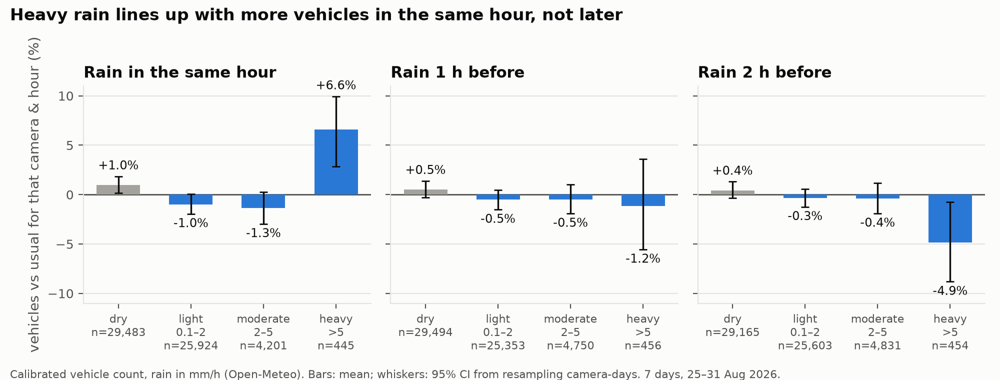
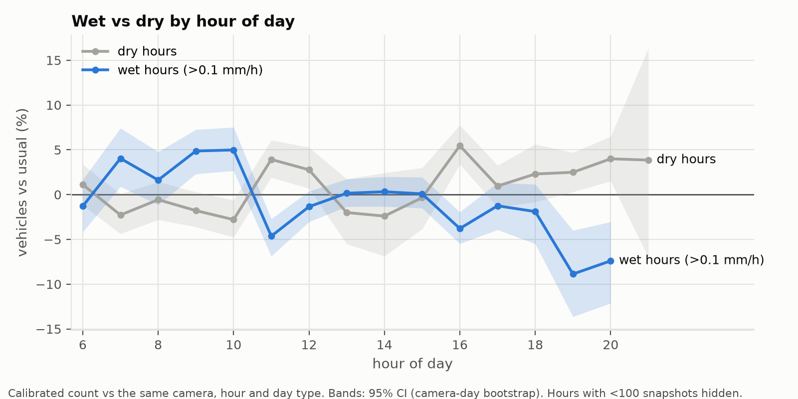
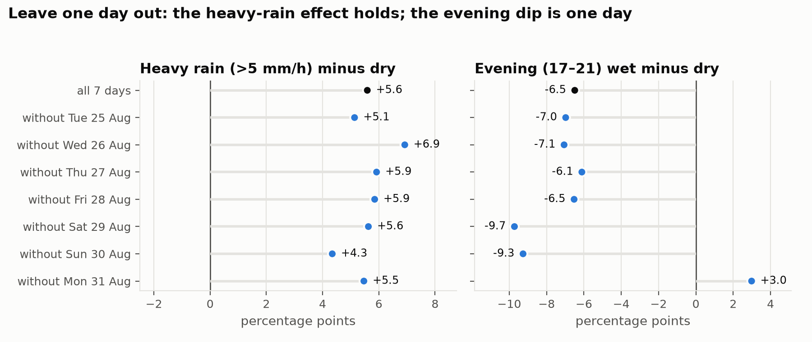
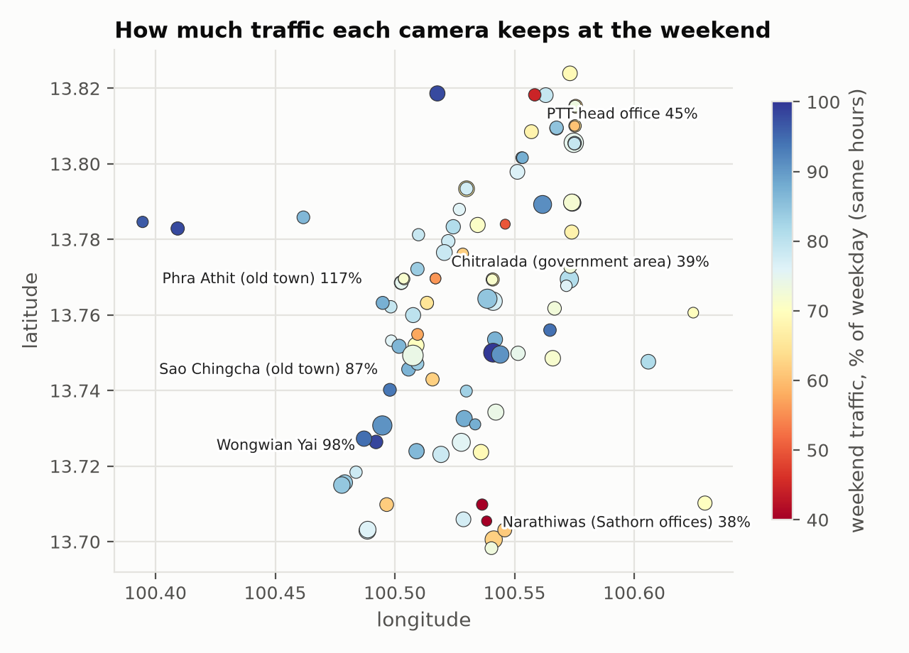
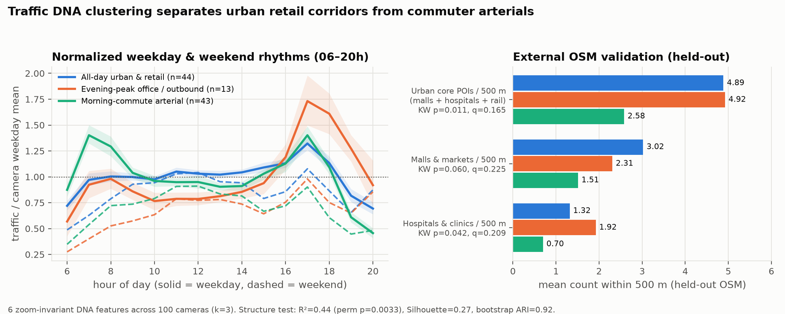
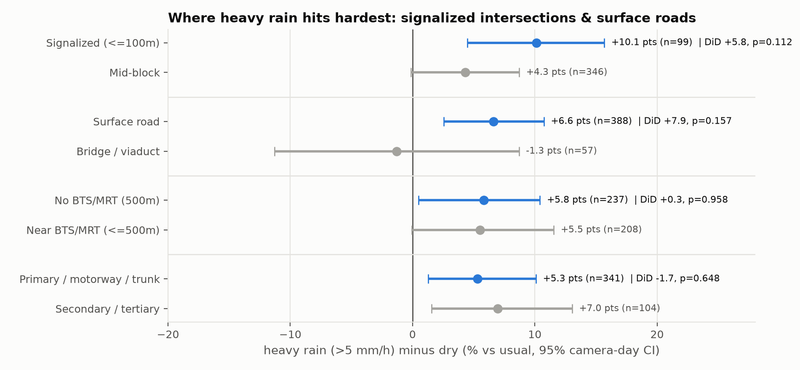
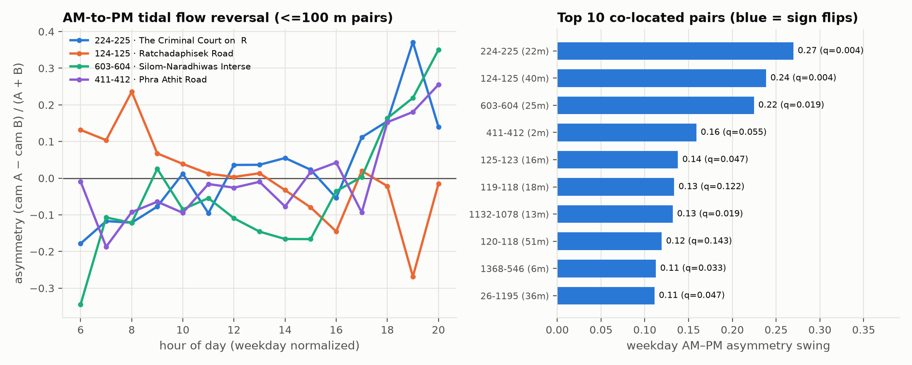
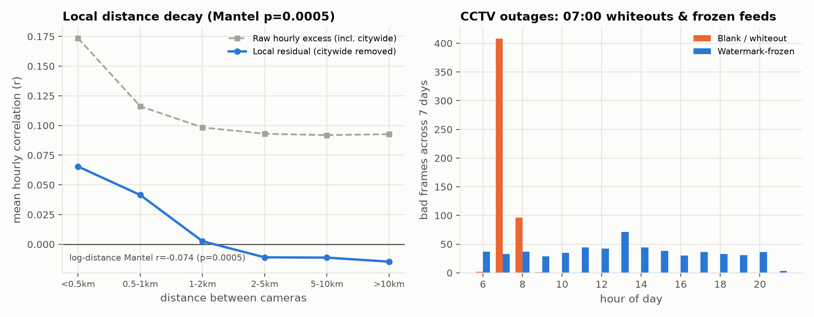
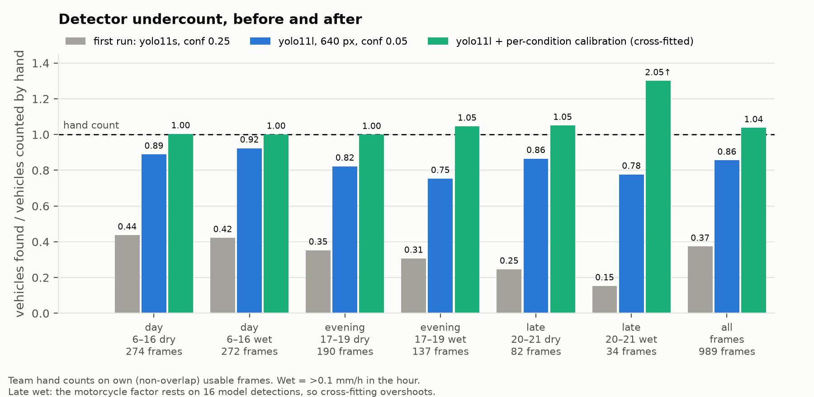

# Does rain make Bangkok roads look more congested? A one-week CCTV case study

*2110403 DSDE final project. Updated with feed-health auditing, Traffic DNA, infrastructure vulnerability DiD, tidal flow, and spatial spillover analyses.*

## Summary

We audited **61,319** CCTV images from 100 Bangkok cameras over one week (Tue 25 – Mon 31 Aug 2026, 06:00–21:00), removing **1,086 corrupted frames** (507 blank including 504 morning whiteouts + 579 watermark-frozen frames missed by MD5 hashes) to obtain **60,053** usable snapshots matched to hourly rainfall from Open-Meteo, road/POI context from OpenStreetMap, and light phases from sunrise-sunset.org. Our team counted vehicles by hand in 1,000 frames to select and calibrate the detector.

- **Heavy rain (>5 mm/h) comes with +6.6% more vehicles than usual** (95% CI +2.9% to +10.0%; dry hours +1.0%, net difference **+5.6 percentage points**, up from +3.7 pts before feed auditing). It holds whichever day is removed (+4.3 to +6.9 pts).
- **Only rain in the same hour increases congestion.** Rain 1 hour earlier sits near zero (−1.2%, CI −5.6% to +3.6%); 2 hours earlier hints at fewer vehicles (−4.9%, CI −8.8% to −0.8%, n=454).
- **Evening anomaly explained:** Dropping Monday 31 Aug flips wet evenings from −6.5 to +3.0 pts. Feed audit isolates Mon 31 Aug evening (≥17:00) as 100% light-wet (0.31–0.60 mm/h) at −17.8% below usual citywide (led by Phra Athit / Samsen shocks down to `z = −7.36`).
- **Traffic DNA clustering (k=3)** splits Bangkok into *All-day urban & retail* (n=44), *Morning-commute arterial* (n=43), and *Evening-peak office / outbound* (n=13) with bootstrap ARI **0.92**, permutation **p = 0.003**, and external OSM validation (`urban_core_pois_500m` KW **p = 0.011**).
- **Infrastructure vulnerability (DiD):** Signalized intersections (≤100 m) absorb **+10.1 pts** vs +4.3 pts mid-block (DiD +5.8, p=0.112), and surface roads **+6.6 pts** vs bridges −1.3 pts (DiD +7.9, p=0.157); BTS/MRT proximity shows no difference (+5.8 vs +5.5 pts, p=0.958).
- **Tidal flow reversal:** Out of 21 co-located camera pairs (≤100 m), **14 flip sign** between weekday AM (06–09 h) and PM (16–19 h), and **7 survive Benjamini-Hochberg FDR q < 0.05** (led by Ratchadaphisek 224–225 & 124–125 at `q = 0.004`).
- **Spatial spillover radius ≤ 1 km:** Double-centered local residuals decay from `+0.065` (<0.5 km) and `+0.042` (0.5–1 km) to `+0.003` at 1–2 km (**Mantel p = 0.0005**), while individual ≤2 km links yield 0/442 below day-block FDR q < 0.05 across 7 days.

## Data

| | |
|---|---|
| Cameras | 100 Bangkok traffic cameras, 352×288 px frames |
| Period | 7 days, 25–31 Aug 2026, 06:00–21:00 |
| Image Audit | 61,319 raw → 60,233 usable (dropped 507 blank/504 whiteouts + 579 watermark-frozen frames) |
| Snapshots analysed | 60,053 (after dropping camera/hour cells with <3 snapshots; 30,570 in wet hours = 51%) |
| Rain | Open-Meteo hourly precipitation at each camera's location (445 heavy, 4,201 moderate, 25,924 light, 29,483 dry) |
| Hand labels | 1,000 frames counted by 5 people; 199 counted twice; 12 marked unusable |

## Method

**Vehicle counts & calibration.** We compared YOLO11 s/m/l/x at 640/960/1280 px against hand counts (tune/test split, `data/labels/bakeoff.csv`). `yolo11l` at 640 px and confidence 0.05 had the lowest test MAE (4.9 vehicles/frame vs 2.7 human-to-human disagreement). Calibration scales model counts per condition (day/evening/late × wet/dry) and class by hand ÷ model with cross-fitting.

**Zoom-free baseline (`excess`).** Each snapshot is compared with the mean of the same camera at the same hour and day type (weekday/weekend):

    excess = log(1 + count) − mean log(1 + count) in that (camera, hour, daytype) cell

Confidence intervals use 2,000 camera-day cluster bootstraps. Structural tests use permutation nulls (structure & cluster-membership for DNA, 5,000 AM↔PM permutations for tidal pairs, 2,000 Mantel & day-block permutations for spatial links) with Benjamini-Hochberg FDR control.

## Results

### Rain level and timing



Heavy rain in the same hour yields **+6.6%** vs usual (95% CI +2.9% to +10.0%; dry +1.0%, difference **+5.6 pts**). Light (−1.0%) and moderate rain (−1.3%) sit within noise of zero. Rain 1 hour earlier shows −1.2% (CI −5.6% to +3.6%); heavy rain 2 hours earlier suggests −4.9% (CI −8.8% to −0.8%, n=454). Raw uncalibrated counts give the same conclusion (+7.0% for heavy rain).

### Time of day & Leave-one-day-out




Across all 7 single-day drops, heavy vs dry stays between **+4.3 and +6.9 pts**. In contrast, dropping Monday 31 Aug flips evening wet vs dry from **−6.5 to +3.0 pts**.

### Weekday vs weekend



Weekends carry **22% fewer vehicles** (13.1 vs 16.7 per frame). After removing 95 frozen weekend frames on Narathiwas Soi 20 (Camera 206), per-camera weekend retention ranges from **35% to 117%** (median 77%): office/government corridors empty out (Makro Narathiwas 35%, Narathiwas 20 38%, Chitralada 39%, PTT 45%) while old-town and retail spots remain full (Phra Athit 117%, Pratunam 100%, Wongwian Yai 98%, Sao Chingcha 87%). Cameras with 3+ malls/markets within 500 m keep **81%** vs **72%** with none (permutation **p = 0.005**).

### Traffic DNA clustering (`k=3`)



Clustering 6 zoom-invariant normalized features yields 3 stable archetypes (**R² = 0.443, perm p = 0.003; Silhouette = 0.273, p = 0.003; bootstrap ARI = 0.919**):
- **All-day urban & retail (n=44):** retains 86% traffic on weekends (77% weekend mornings), highest malls (3.02 / 500 m).
- **Morning-commute arterial (n=43):** morning peak (1.15×), low night volume (0.53×), lowest urban-core POIs (2.58 / 500 m).
- **Evening-peak office / outbound (n=13):** steep evening surge (1.45×), drops on weekends (67%), highest hospital proximity (1.92 / 500 m).
External Kruskal-Wallis validation confirms clusters separate held-out OSM `urban_core_pois_500m` (**H = 8.43, p = 0.011**; All-day vs Morning **p = 0.002**).

### Infrastructure rain vulnerability (DiD)



- **Signalized intersections (≤100 m):** **+10.1 pts** (CI +4.5 to +15.7, n=99) vs mid-block **+4.3 pts** (DiD +5.8 pts, p=0.112).
- **Surface roads vs bridges:** **+6.6 pts** (CI +2.6 to +10.7, n=388) vs bridges/viaducts **−1.3 pts** (n=57; DiD +7.9 pts, p=0.157).
- **Honest nulls:** BTS/MRT proximity (≤500 m vs >500 m: +5.5 vs +5.8 pts, p=0.958) and road class (primary+ +5.3 vs secondary +7.0 pts, p=0.648) show no differential rain effect. Interaction DiD CIs still cross zero with 445 heavy-rain snapshots.

### Tidal flow & directional asymmetry



Among 21 co-located camera pairs (≤100 m), **14 flip sign** between weekday AM (06–09 h) and PM (16–19 h), and **7 pass Benjamini-Hochberg FDR q < 0.05**:
- **224–225** (Criminal Court @ Ratchadaphisek, 21.7 m): swing **0.270**, reverses 4/5 weekdays (**q = 0.004**).
- **124–125** (Police box @ Ratchadaphisek, 39.8 m): swing **0.238**, reverses **5/5 weekdays (q = 0.004)**.
- **603–604** (Silom–Naradhiwas, 24.8 m): swing **0.225**, reverses 4/5 weekdays (**q = 0.019**).
- **1132–1078** (Wat Suwan flyover, 13.0 m, **q = 0.019**), **1368–546** (Lan Phra Rup, 5.8 m, **q = 0.033**), **125–123** (**q = 0.047**), **26–1195** (Mahai Sawan, **q = 0.047**).

### Spatial spillover & CCTV feed health audit



- **Spatial decay:** Removing citywide hourly means shrinks raw correlation (`0.093` even at >10 km) into a local residual radius bounded within **1 km**: `+0.065` (<0.5 km) → `+0.042` (0.5–1 km) → `+0.003` (1–2 km) → `−0.015` (>10 km). Mantel tests confirm distance decay (`corr(local_r, log_dist) = −0.074, p = 0.0005`; near ≤1 km vs far >2 km diff `+0.062, p = 0.0005`). Under day-block permutation across 7 days, 0/442 pairs clear individual FDR q < 0.05 (top link `119–1112` Ratchada–Sutthisan `local_r = 0.464, p = 0.008, q = 0.321`).
- **Feed audit & shocks:** Across 7 days we detected **262 traffic shocks** (`|z| ≥ 2.5`): **207 localized** (e.g., Triam Udom 239 `z = +4.87`), **18 corridor**, and **37 citywide** led by Mon 31 Aug evening (−17.8% citywide, Cam 414 `z = −7.36`). Worst cameras by outage rate: `150` (20.1%), `938` (17.0%), `939` (17.0%), `206` (16.4%), `395` (12.5%).

### Detector error



The first run (`yolo11s`, confidence 0.25) found 37% of hand-counted vehicles overall and only 15% in late wet hours. `yolo11l` at 640 px with threshold 0.05 finds 75–92% in every condition; cross-fitted calibration brings each condition to ~1.00 (except late wet hours with 34 frames, though uncalibrated counts give the same heavy-rain result).

## Limitations

- **One week (445 heavy-rain snapshots):** Enough for main effects, tidal pairs, and network-wide Mantel tests, but limits power for interaction DiD CIs and 7-day day-block per-link FDR.
- **Area-level hourly rain:** Open-Meteo is gridded and averages sub-hour storms over full hours.
- **Counts are not speed:** 10-minute snapshots cannot directly separate slower queues from higher throughput.
- **Human disagreement (2.7 vehicles/frame)** and lens rain blur individual frames.

## Reproduce

```bash
uv run python -m cctv.pipeline
uv run streamlit run src/cctv/dashboard.py
```
