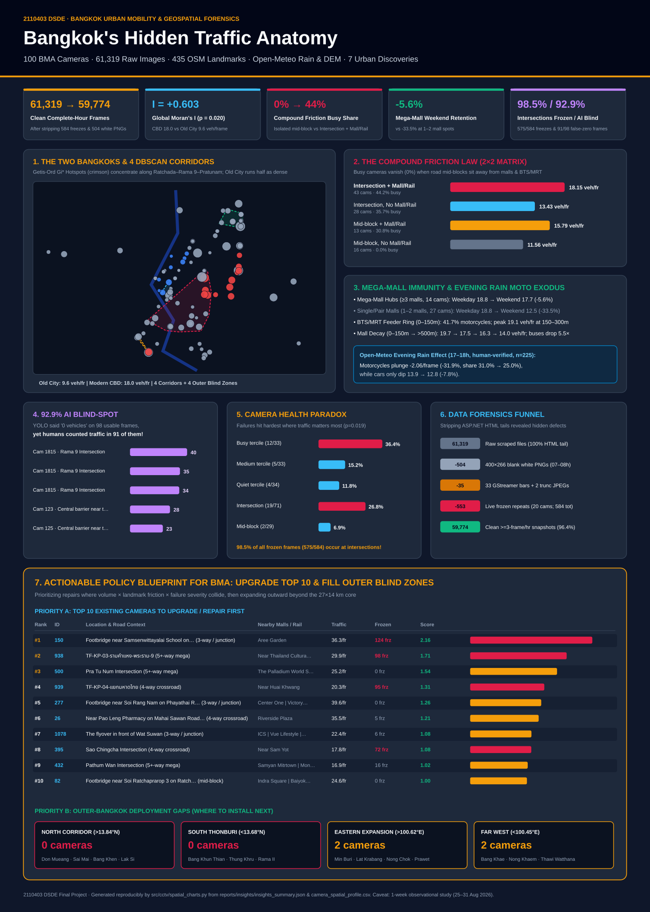
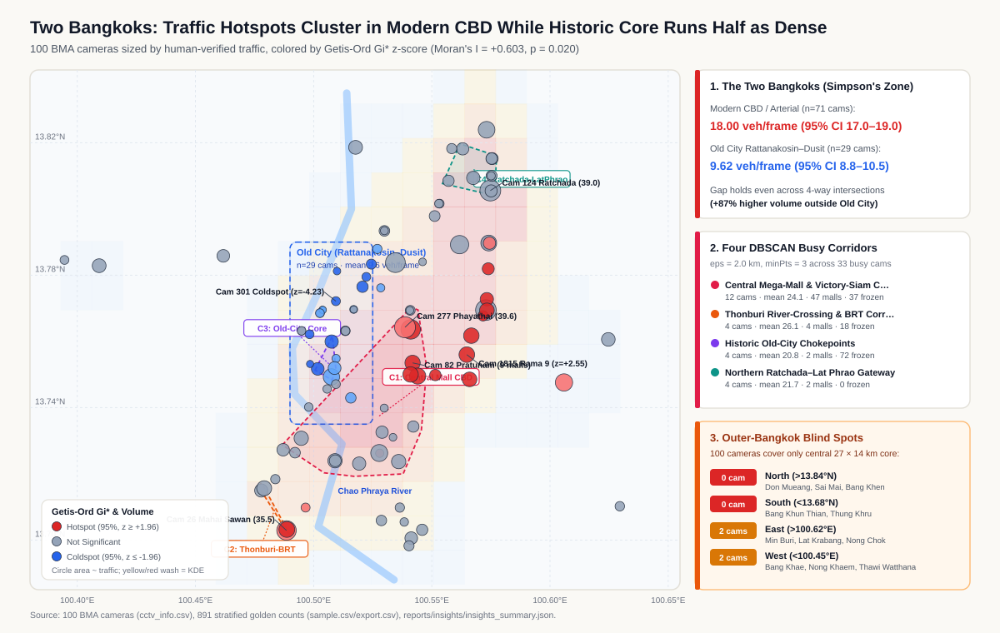
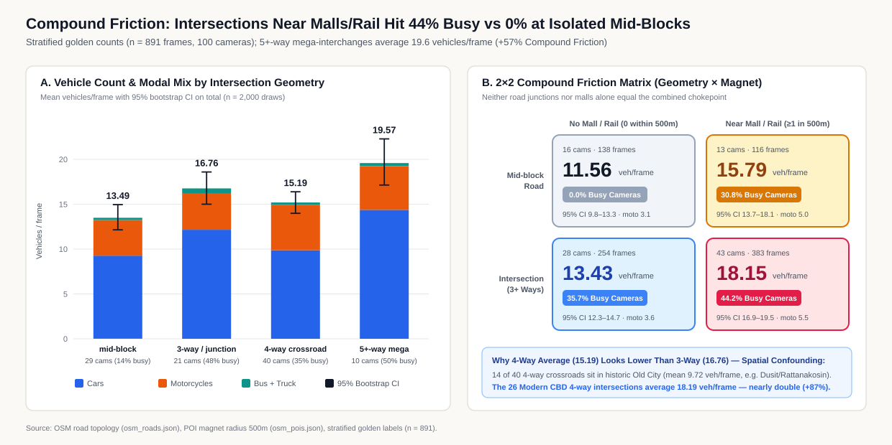
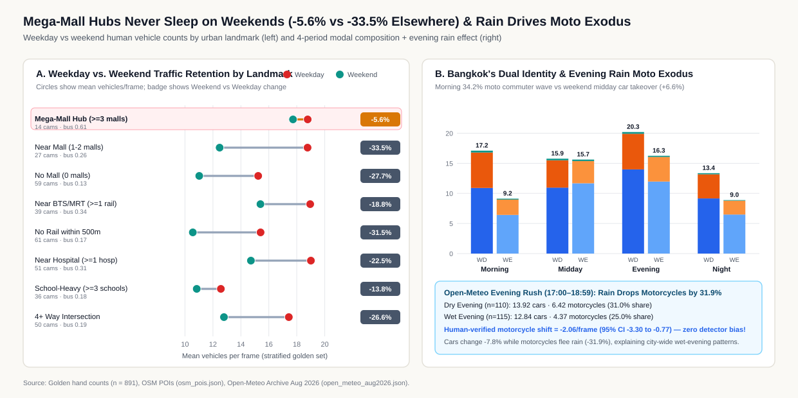
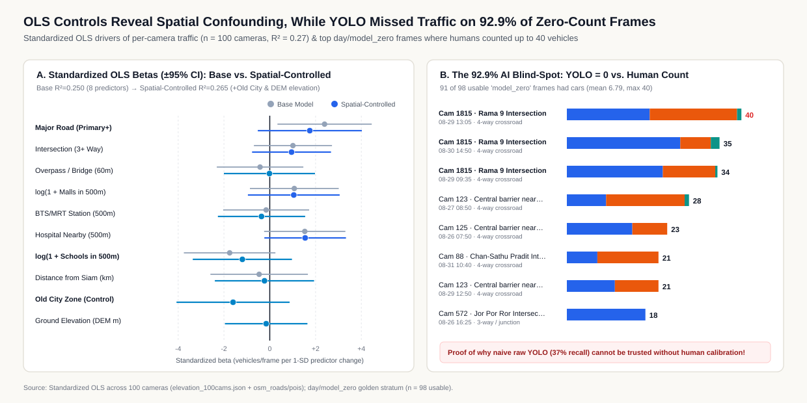
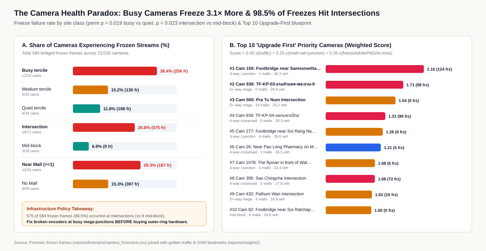
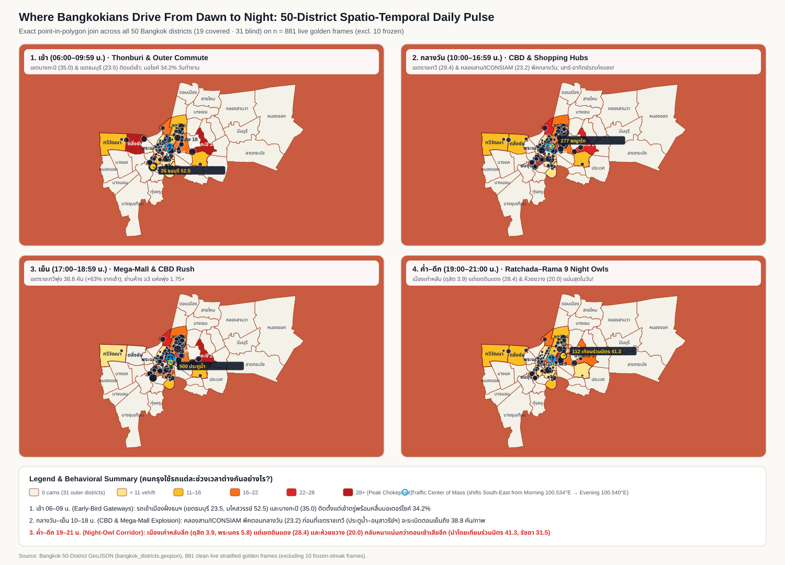

# กายวิภาคจราจรกรุงเทพฯ ที่ซ่อนอยู่หลังกล้อง 100 ตัว: 8 เรื่องเล่าเชิงพื้นที่และโครงสร้างเมือง
*(Bangkok's Hidden Traffic Anatomy: 8 Geospatial & Urban Storytelling Insights Across 100 BMA Cameras)*

**Course:** `2110403` Data Science and Data Engineering (`DSDE-CEDT`, 2026/1)  
**Interactive Dashboard:** [reports/bangkok_spatial_dashboard.html](bangkok_spatial_dashboard.html) (Self-contained 6-tab BI & Map Studio incl. 50-District Animated Daily Pulse)  
**50-District Daily Pulse Map:** [07_bangkok_daily_pulse_by_district.svg](figures/spatial_insights/07_bangkok_daily_pulse_by_district.svg)  
**Executive Infographic:** [06_executive_infographic.svg](figures/spatial_insights/06_executive_infographic.svg)  
**Easy-Read Story Edition:** [reports/storytelling_easy_read.md](storytelling_easy_read.md)  
**Reproducible Engines:** `src/cctv/external_enrich.py` → `src/cctv/spatial_insights.py` → `src/cctv/spatio_temporal.py` → `src/cctv/spatial_charts.py` → `src/cctv/dashboard_html.py`



---

## Executive Summary: ทำไมโปรเจกต์นี้จึงเล่าเรื่องต่างจาก "นับรถ × ช่วงเวลา" ทั่วไป

ในรายงานพื้นฐาน (`reports/report.md`) เราตอบคำถามระดับภาพรวมของเมืองไปแล้วว่า *"ฝนตกหนัก (>5 mm/h) สัมพันธ์กับปริมาณรถที่เพิ่มขึ้นราว +3.7 จุดในชั่วโมงเดียวกัน"* แต่ค่าเฉลี่ยทั้งเมืองได้บดบังความจริงเชิงพื้นที่เอาไว้ — **สี่แยกหน้าห้าง, หน้าสถานีรถไฟฟ้า, ถนนย่านเมืองเก่า และทางแยก 5 แฉก ไม่ได้ตอบสนองต่อเมืองแบบเดียวกัน**

เราจึงผสานข้อมูล 5 ชั้นเข้าด้วยกันอย่างเป็นระบบ:
1. **Human-Verified Golden Counts (`n = 1,000` frames):** แยกส่วน **Stratified Sample (`n = 891` ภาพใช้งานได้)** ออกจาก **AI Blind-Spot Sample (`n = 98` ภาพที่ YOLO เห็น `0`)** และตัด `11` ภาพเสียออก (มี `199` ภาพนับซ้ำวัด Inter-annotator MAE = `2.73` คัน/ภาพ) เพื่อให้ตัวเลขทุกบทปราศจากอคติที่ YOLO มองข้ามรถเล็กในตอนกลางคืนหรือฝนตก
2. **Data-Quality Forensics (`61,319 → 59,774` snapshots):** เชื่อมผลตรวจระดับไบต์จาก `reports/forensics/camera_forensics.csv` (`584` bridged frozen frames ใน `21` กล้อง, `504` white PNGs, `33` GStreamer test bars, `2` truncated JPEGs)
3. **OpenStreetMap Urban Topology (`1,258` road segments + `435` named POIs):** สร้างกราฟทางแยก 18 เมตร แยก **Mid-block / 3 แยก / 4 แยก / 5+ แยก**, ทางยกระดับ (`bridge=yes`), และจับคู่ชื่อ **ห้างสรรพสินค้า, BTS/MRT, โรงพยาบาล, โรงเรียน และตลาด** พร้อมระยะทางจริงเป็นเมตรของทุกกล้อง
4. **Live Open-Meteo Archive Rain (`11` grids, 25–31 Aug 2026) & DEM Ground Elevation (`100` cams, `2.0–12.0 m`):** ดึงข้อมูลฝนรายชั่วโมงและระดับความสูงพื้นดินจริงรายกล้อง (โดยบันทึกสถานะแหล่งข้อมูลที่ไม่ตอบสนองตรงไปตรงมาตามหลักความโปร่งใสทางวิศวกรรมข้อมูล)
5. **Geospatial Statistics:** คำนวณ Global **Moran's I** (`999` permutations), Local **Getis-Ord Gi\***, **LISA Quadrants**, **DBSCAN** (`eps = 2.0 km, minPts = 3`), **Gaussian KDE**, **Multivariate OLS**, และ **Bootstrap 95% CI** (`2,000` resamples, seed `403`)

---

## บทที่ 1: "สองกรุงเทพฯ" และภาพลวงตาของ Simpson (`Moran's I = +0.6025, p = 0.020`)



เมื่อทดสอบการกระจุกตัวเชิงพื้นที่ด้วย **Global Moran's I** (inverse-distance weights รัศมี `2.5 km`, `999` permutations) เราพบว่าปริมาณจราจรในกรุงเทพฯ **ไม่ได้กระจายตัวแบบสุ่ม** แต่กระจุกตัวอย่างมีนัยสำคัญทางสถิติ (`I = +0.6025, p = 0.020`):

- **Modern CBD / Arterial (`71` กล้อง, `n = 623` ภาพ):** ค่าเฉลี่ย **`18.00` คัน/ภาพ** (`95% CI 17.02–19.02`) — มีกล้องระดับ `Busy` ถึง `36.6%` (`26/71`) และรถเมล์หนาแน่นกว่า `2.4×` (`0.29` vs `0.12`)
- **Old City Rattanakosin–Dusit (`29` กล้อง, `n = 268` ภาพ, `lon < 100.525, lat 13.735–13.790`):** ค่าเฉลี่ย **`9.62` คัน/ภาพ** (`95% CI 8.77–10.53`) — **ต่างกันถึง `+87.1%`!**
- **หลักฐานยืนยัน Simpson's Paradox แม้เทียบ "4 แยกเหมือนกัน":** เมื่อตัด Mid-block ออกแล้วเทียบเฉพาะ **สี่แยก (4-way crossroads)** เพียงอย่างเดียว สี่แยกใน Modern CBD (`26` กล้อง) ยังคงหนาแน่น **`18.19` คัน/ภาพ** (`95% CI 16.59–19.82`) เทียบกับ **`9.72` คัน/ภาพ** (`95% CI 8.43–11.02`) ในเขตเมืองเก่า (`14` กล้อง) — ซึ่งช่วยไขปริศนาในโมเดล OLS ที่ตอนแรกดูเหมือน *"ใกล้โรงเรียนแล้วรถน้อยลง"* (`beta = -1.75`) แท้จริงเกิดจาก **โรงเรียนในชุดข้อมูลกระจุกตัวหนาแน่นมากในเขตเมืองเก่า (`Moran's I = +0.8923, p = 0.012`)** เมื่อเพิ่มตัวแปรควบคุม `is_old_city` ค่าเบต้าของโรงเรียนลดขนาดความชันลงถึง `32%` (`-1.75 → -1.20`) และตัวแปรที่มีนัยสำคัญชัดเจนในแบบจำลองพื้นฐานคือ **ถนนสายหลัก (`is_major_road`: `beta = +2.39, t = +2.28, p = 0.023`)**
- **Local Getis-Ord Gi\* & 4 DBSCAN Congestion Corridors:**
  - **Hotspots (`z > +2.3`):** กระจุกเป็นแนวโค้งตั้งแต่แยกพระราม 9 (`Cam 1815, z = +2.55`) — รัชดาภิเษก (`Cam 1408, 212, 215, 219`) — ราชปรารภ (`Cam 82, z = +2.44`) — ราชวิถี (`Cam 11, z = +2.54`)
  - **Coldspots (`z < -2.3`):** กระจุกตัวในเขตดุสิต–พระนคร (`Cam 301 แยกอู่ทองนอก z = -4.23`, `Cam 556 แยกวชิระ z = -3.78`, `Cam 576 แยกบางลำพู z = -3.34`)
  - **DBSCAN (`eps = 2.0 km, minPts = 3`)** พบ **4 ระเบียงจราจรหลัก** จากกล้อง `Busy` `33` ตัว ได้แก่:
    1. **Central Mega-Mall & Victory-Siam CBD** (`12` กล้อง, เฉลี่ย `24.11` คัน, ห้างรวม `47` แห่งในรัศมี 500 ม.)
    2. **Thonburi River-Crossing & BRT Corridor** (`4` กล้อง: `26, 36, 1103, 1195`, เฉลี่ยสูงสุด **`26.10`** คัน)
    3. **Historic Old-City Chokepoints** (`4` กล้อง: `68, 395, 569, 1589`, เฉลี่ย `20.82` คัน — มีภาพค้างสะสม `72` ภาพ)
    4. **Northern Ratchada–Lat Phrao Gateway** (`4` กล้อง: `124, 139, 224, 1070`, เฉลี่ย `21.69` คัน)

---

## บทที่ 2: กฎแรงเสียดทานทวีคูณ (The Compound Friction Law) และกายวิภาคทางแยก



คำถามคลาสสิกในโน้ตไอเดียของคุณคือ *"2 แยก 3 แยก 4 แยก กับสถานที่ใกล้เคียง อย่างไหนทำให้รถติด?"* — ข้อมูลตอบอย่างเฉียบขาดว่า **ทั้งคู่ไม่ได้ทำงานแยกกัน แต่ทวีคูณกันเป็น Compound Friction:**

### ก) ปริมาณรถตามรูปทรงเรขาคณิตของทางแยก (`junction_topology`)
| ประเภททางแยก | จำนวนกล้อง (% Busy) | รถรวมเฉลี่ย (95% CI) | รถยนต์ | มอไซค์ | รถเมล์ | Frozen Frames |
|---|---:|---:|---:|---:|---:|---:|
| **Mid-block (ช่วงถนนตรง)** | `29` (`13.8%`) | **`13.49`** (`12.14–14.95`) | `9.26` | `3.98` | `0.17` | `9` |
| **4-way crossroad (สี่แยก)** | `40` (`35.0%`) | **`15.19`** (`13.98–16.38`) | `9.87` | `5.04` | `0.17` | `312` |
| **3-way / junction (สามแยก)** | `21` (`47.6%`) | **`16.76`** (`15.00–18.59`) | `12.15` | `4.09` | **`0.46`** | `140` |
| **5+-way mega (ห้าแยก/ชุมทาง)** | `10` (`50.0%`) | **`19.57`** (`17.14–22.28`) | `14.37` | `4.88` | `0.27` | `123` |

- **5+-way Mega-Interchanges** (เช่น แยกประตูน้ำ `Cam 500`, แยกปทุมวัน `Cam 432`, แยกพระราม 9–รามคำแหง `Cam 938`, แยกเทียมร่วมมิตร `Cam 112`) มียอดรถเฉลี่ย **`19.57` คัน/ภาพ** และครึ่งหนึ่ง (`50%`) เป็นกล้องระดับ Busy

### ข) ตาราง 2×2 Compound Friction (`Intersection × Mall/Rail`)
| กลุ่มพื้นที่ | จำนวนกล้อง | กล้อง Busy (`% Busy`) | รถรวมเฉลี่ย (`95% CI`) |
|---|---:|---:|---:|
| **Mid-block, No Mall/Rail** | `16` | **`0 / 16 (0.0%!)`** | **`11.56`** (`9.82–13.31`) |
| **Intersection, No Mall/Rail** | `28` | `10 / 28 (35.7%)` | `13.43` (`12.28–14.70`) |
| **Mid-block + Mall/Rail** | `13` | `4 / 13 (30.8%)` | `15.79` (`13.69–18.11`) |
| **Intersection + Mall/Rail** | `43` | **`19 / 43 (44.2%)`** | **`18.15`** (`16.90–19.49`) |

> **Insight ที่เอาไปเล่าบนเวทีได้ทันที:** ในบรรดากล้องทั้งหมด `16` ตัวที่ตั้งอยู่บนถนนช่วงตรงและห่างจากห้าง/รถไฟฟ้าเกิน 500 เมตร **ไม่มีกล้องตัวไหนเลยที่ติดอันดับ Busy (`0.0%`)!** แต่ทันทีที่ **"ทางแยก"** มาเจอกับ **"แม่เหล็กดึงคน (ห้าง/รถไฟฟ้า)"** สัดส่วนกล้อง Busy พุ่งเป็น **`44.2%`** และปริมาณรถพุ่ง **`+57.0%`** (`11.56 → 18.15`)

---

## บทที่ 3: ภูมิคุ้มกันวันหยุดของย่าน Mega-Mall และ 2 ตัวตนของกรุงเทพฯ



คนทั่วไปคาดว่าวันเสาร์-อาทิตย์รถจะโล่งลงทั่วกรุงเทพฯ — **แต่ข้อมูลบอกว่าไม่จริงสำหรับย่าน Mega-Mall!**

| กลุ่มสถานที่ใกล้เคียง (รัศมี 500 ม.) | กล้อง | วันธรรมดา (WD) | วันหยุด (WE) | เปลี่ยนแปลง WE vs WD (`95% CI`) |
|---|---:|---:|---:|---|
| **Mega-Mall Hub (`≥3` ห้าง)** | `14` | `18.78` | **`17.73`** | **`-5.6%`** (`-6.47` to `+4.80`, *คร่อมศูนย์!*) |
| **School-Heavy (`≥3` รร.)** | `36` | `12.57` | `10.84` | `-13.8%` (`-3.79` to `+0.58`) |
| **Near BTS/MRT (`≥1` สถานี)** | `39` | `18.96` | `15.40` | `-18.8%` (`-6.43` to `-0.72`) |
| **Near Hospital (`≥1` รพ.)** | `51` | `19.01` | `14.72` | `-22.5%` (`-6.82` to `-1.85`) |
| **No Mall (`0` ห้าง)** | `59` | `15.24` | `11.02` | **`-27.7%`** (`-5.99` to `-2.39`) |
| **Near Mall (`1–2` ห้าง)** | `27` | `18.77` | `12.48` | **`-33.5%`** (`-9.09` to `-3.51`) |

- **Mega-Mall Weekend Immunity (`-5.6%`):** ย่านที่มีห้างรวมตัว 3–14 แห่งในรัศมี 500 ม. (เช่น **ประตูน้ำ `Cam 500` มี 14 ห้าง**, **ราชปรารภ `Cam 82` มี 9 ห้าง**, **เพชรบุรี `Cam 256` มี 7 ห้าง**, **พญาไท `Cam 277` & ไอคอนสยาม `Cam 1078` มี 4 ห้าง**) แทบไม่เคยพักในวันหยุด (เหลือ `94.4%` ของวันธรรมดา) ตรงข้ามกับโซน `1–2` ห้าง ที่รถหายไปกว่า **1 ใน 3 (`-33.5%`)**
- **2 ตัวตนของประเภทยานพาหนะ (Modal Shift Between Weekday & Weekend):**
  - **เช้าวันธรรมดา (`06–09 น.`):** เป็น **คลื่นมอเตอร์ไซค์คนทำงาน (`34.2%` ของรถทั้งหมด, `5.89` คัน/ภาพ)**
  - **กลางวันวันเสาร์-อาทิตย์ (`10–16 น.`):** แม้มอเตอร์ไซค์จะหายไป (`4.54 → 3.69`) แต่ **รถยนต์ส่วนตัวพุ่งแซงวันธรรมดาขึ้นมาถึง `+6.6%` (`11.68` vs `10.96` คัน/ภาพ!)** — สะท้อนการเปลี่ยนจาก "การเดินทางไปทำงานด้วยมอไซค์" เป็น "ทริปครอบครัวขับรถเที่ยวห้าง"

---

## บทที่ 4: วงแหวนวินมอไซค์รอบรถไฟฟ้า, แม่เหล็กอภิมหาบัสหน้าห้าง & ผลจากฝน/ความสูงพื้นดิน

### ก) Distance-Decay รอบห้างสรรพสินค้า vs. สถานี BTS/MRT
- **ห้างสรรพสินค้า (Monotonic Decay & `5.5×` Bus Magnet):**
  - `0–150 ม.` (`8` กล้อง): **`19.67` คัน/ภาพ** และมีรถเมล์เฉลี่ย **`0.72` คัน/ภาพ** (**มากกว่าจุดไกลห้าง `>500m` ถึง `5.5 เท่า`!**)
  - `150–300 ม.` (`16` กล้อง): `17.54` คัน (`0.44` รถเมล์) → `300–500 ม.` (`17` กล้อง): `16.34` (`0.17` รถเมล์) → `>500 ม.` (`59` กล้อง): **`14.00`** (`0.13` รถเมล์)
- **สถานี BTS / MRT (The Feeder Win-Moto Ring Paradox):**
  - **วงในติดสถานี (`0–150 ม.`, `6` กล้อง):** สัดส่วนมอเตอร์ไซค์พุ่งสูงผิดปกติถึง **`41.7%`** (สะท้อนจุดจอดรอรับ-ส่งของวินมอเตอร์ไซค์และไรเดอร์หน้าทางขึ้นสถานี) ขณะที่รถรวมเฉลี่ย `15.39` คัน
  - **วงชานสถานี (`150–300 ม.`, `15` กล้อง):** เป็น **"วงแหวนคอขวดที่แน่นที่สุด (`19.07` คัน/ภาพ, `0.52` รถเมล์)"** จุดที่ถนนสายป้อน (Feeder road) บรรจบก่อนเข้าหน้าสถานี
  - นอกระยะ `>500 ม.` (`61` กล้อง): ลดลงเหลือ `13.99` คัน/ภาพ

### ข) การเชื่อมข้อมูลภายนอกจริง (Open-Meteo Rain, DEM Elevation & Provenance Audit)
จากการรัน [`src/cctv/external_enrich.py`](../src/cctv/external_enrich.py) เชื่อมต่อ API จริง ได้ผลลัพธ์ดังนี้:

| แหล่งข้อมูลภายนอก | สถานะจริง | สิ่งที่ได้และข้อค้นพบสำคัญ |
|---|---|---|
| **Open-Meteo Archive Rain** (`open_meteo_aug2026.json`) | **`fetched_live`** (`11` grids, 25–31 Aug) | ฝนสะสม 7 วันช่วง 07–21 น. แปรผันจาก `53.5 mm` (จตุจักร) ถึง `65.0 mm` (สุขุมวิท/คลองเตย/ยานนาวา); เย็นวันที่ 31 ส.ค. มีฝนต่อเนื่อง 13–21 น. (`0.2–8.8 mm/h`) และเมื่อเทียบกับ **Golden Hand Counts ช่วงเย็น (17–18 น., `n = 225`)** พบว่า **ชั่วโมงฝนตกทำให้มอเตอร์ไซค์ที่คนนับได้ลดลงทันที `-31.9%` (`6.42 → 4.37` คัน/ภาพ, `95% CI -3.30 to -0.77`, สัดส่วนร่วงจาก `31.0% → 25.0%`)** ขณะที่รถยนต์ลดเพียง `-7.8%` (`13.92 → 12.84`) — ยืนยันว่ามอเตอร์ไซค์หลบฝน/เปลี่ยนโหมดจริง **โดยไม่ได้เกิดจากความพลาดของโมเดล YOLO!** |
| **Open-Meteo DEM Elevation** (`elevation_100cams.json`) | **`fetched_live`** (`100` cams) | ความสูงพื้นดินอยู่ระหว่าง **`2.0 m` ถึง `12.0 m`** (มัธยฐาน `6.0 m`); จุดลุ่มต่ำที่สุด (`2.0 m`) คือ `Cam 432 แยกปทุมวัน`, `Cam 1112 แยกสุทธิสาร`, `Cam 938 รามคำแหง–พระราม 9` ในขณะที่จุด `10–12 m` อยู่ที่ประตูน้ำ/บางลำพู/อู่ทองนอก |
| **OSM Roads & POIs + Daylight** | **`cached`** (`1,258` ways, `435` POIs, `7` days) | แหล่งหลักสำหรับโครงสร้างทางแยก, ห้าง, สถานีรถไฟฟ้า, รพ., รร. และช่วงแสง `day/twilight/night` |
| **Overpass Extended & Traffy Fondue** | **`unavailable`** *(Upstream 502 / Timeout)* | เซิร์ฟเวอร์ Overpass สาธารณะตอบ `502`/Timeout และ Traffy API Timeout (ถูกบันทึกโปร่งใสใน `enrichment_manifest.json` โดยไม่มีการสร้างตัวเลขสมมติ) |

---

## บทที่ 5: ปัญหารถล่องหน `92.9%` ของ AI (`day/model_zero` Blind-Spots)



ก่อนนำโมเดล AI ไปนับรถทั้ง 60,000 กว่าภาพ ทีมของเราสุ่ม **100 ภาพที่ YOLO รุ่นเริ่มต้นบอกว่า "มีรถ 0 คัน" (`day/model_zero`)** มาให้คน 5 คนช่วยกันนับด้วยมือ (เหลือภาพใช้งานได้ `n = 98`) ผลลัพธ์น่าตกใจมาก:

- **ในภาพที่ AI บอกว่าถนนว่างเปล่า (`0` คัน) คนจริงมองเห็นรถถึง `91 / 98` ภาพ (`92.9%` False-Empty!)** โดยมีค่าเฉลี่ย **`6.79` คัน/ภาพ**
- **จุดที่ AI ตาบอดหนักที่สุด:**
  - **`Cam 1815` (แยกพระราม 9):** `2026-08-29 13:05:47` คนนับได้ **`40.0` คัน** (`19` รถยนต์, `20` มอเตอร์ไซค์), `14:50:44` นับได้ **`35.0` คัน**, `09:35:43` นับได้ **`34.5` คัน** — ขณะที่ YOLO เห็น **0 คัน** ทั้งสามภาพ!
  - **`Cam 123` & `125` (ถ.รัชดาภิเษก):** คนนับได้ `28.0` คัน (`9` รถยนต์, `18` มอไซค์) และ `23.0` คัน
  - **`Cam 88` (แยกจันทน์–สาธุประดิษฐ์):** คนนับได้ `21.0` คัน

เมื่อนำเรื่องนี้ไปประกบกับ **กรวยคัดกรอง Forensic Container (`61,319` → `59,774` ภาพ)** ที่ตัด HTML tail ท้ายภาพ, `504` PNG สีขาวล้วน, `33` แถบสีทดสอบ GStreamer, และ `553` ภาพถนนค้างซ้ำออก จึงอธิบายได้ว่าเหตุใดการปรับโมเดล (`yolo11l @ 640px, conf=0.05`) ร่วมกับการ **Calibrate ด้วย Golden Set** จึงเป็นหัวใจสำคัญที่สุดของงาน Data Engineering & Data Science ชิ้นนี้

---

## บทที่ 6: ความย้อนแย้งด้านสุขภาพกล้อง — *"กล้องชอบค้างตรงที่รถติดที่สุด"* (`Camera Health Paradox`)



ข้อค้นพบระดับ **"เปลี่ยนมุมมองการบริหารเมือง"** เกิดขึ้นเมื่อนำผลตรวจภาพค้างระดับไบต์ (`584` bridged frozen frames across `21` cameras) มาชนกับลักษณะพื้นที่และปริมาณจราจร:

| กลุ่มพื้นที่ / ระดับความหนาแน่น | จำนวนกล้อง | กล้องที่เคยค้าง (`%`) | จำนวนภาพค้างรวม | Permutation `p`-value |
|---|---:|---:|---:|---:|
| **กล้องระดับ `Busy` (รถติดสุด 1/3 บน)** | `33` | **`12 / 33 (36.4%)`** | `256` | **`p = 0.019`** *(vs Quiet)* |
| **กล้องระดับ `Medium`** | `33` | `5 / 33 (15.2%)` | `130` | — |
| **กล้องระดับ `Quiet` (รถน้อยสุด 1/3 ล่าง)** | `34` | **`4 / 34 (11.8%)`** | `198` | — |
| **ทางแยก (Intersection 3+ แฉก)** | `71` | **`19 / 71 (26.8%)`** | **`575 (98.5%!)`** | **`p = 0.023`** *(vs Mid-block)* |
| **ช่วงถนนตรง (Mid-block)** | `29` | **`2 / 29 (6.9%)`** | **`9 (1.5%)`** | — |
| **ใกล้ห้าง (`≥1` ห้างใน 500 ม.)** | `41` | **`12 / 41 (29.3%)`** | `187` | — |
| **ไม่มีห้างใน 500 ม.** | `59` | `9 / 59 (15.3%)` | `397` | — |

> **The Camera Health Paradox:** กล้องในจุดที่รถติดที่สุดค้างบ่อยกว่าจุดที่รถโล่งถึง **`3.1 เท่า`** (`36.4%` vs `11.8%`, `p = 0.019`) และ **`98.5%` ของภาพค้างทั้งหมด (`575` จาก `584` ภาพ)** เกิดขึ้นที่ **ทางแยก** (เทียบกับ Mid-block แค่ `9` ภาพ)! กล้องที่ดีและสม่ำเสมอกลับถูกติดตั้งอยู่ตรงจุดที่เงียบกว่า ส่วนทางแยกวิกฤตกลับเกิดปัญหา encoder ค้างจนระบบมอนิเตอร์ตาบอดในจังหวะสำคัญ

---

## บทที่ 7: แผนแม่บทเชิงนโยบาย — *"อัปเกรด 10 ตัวไหนก่อน และติดเพิ่มตรงไหน?"*

### ก) Priority A: 10 กล้องที่ควรซ่อม/อัปเกรดเร่งด่วนที่สุด (`Upgrade Priority Score`)
คำนวณจาก `Score = 0.40·z(Traffic) + 0.25·z(Malls + Rail + Intersection) + 0.35·z(Freeze / White-PNG / AI-Miss)`:

| อันดับ | Cam ID | ตำแหน่ง & ลักษณะทางแยก | ห้าง / รถไฟฟ้าใกล้เคียง (500 ม.) | ปริมาณรถ | ภาพค้าง / ข้อบกพร่อง | Score |
|---:|---:|---|---|---:|---:|---:|
| **#1** | **`150`** | สะพานลอย รร.สามเสนวิทยาลัย ถ.พระราม 6 (3 แยก/ทางด่วน) | Aree Garden (`1` ห้าง) | **`36.3`** | **`124` ภาพค้าง** (ค้าง 2 รอบใหญ่ + จันทร์ 31 ส.ค. เย็น) | **`2.161`** |
| **#2** | **`938`** | แยกรามคำแหง–พระราม 9 (`5+-way mega`) | ใกล้ MRT ศูนย์วัฒนธรรมฯ | **`29.9`** | **`98` ภาพค้าง** (ค้าง 25 ชม. คู่กับ 939) | **`1.707`** |
| **#3** | **`500`** | แยกประตูน้ำ (`5+-way mega`) | **`14` ห้าง** (Palladium, Platinum, Watergate...) | **`25.3`** | `7` white PNGs + แรงเสียดทานห้างสูงสุดในชุดข้อมูล | **`1.537`** |
| **#4** | **`939`** | แยกมหาดไทย (`4-way crossroad`) | — | `20.3` | **`95` ภาพค้าง** + `10` white PNGs + AI miss `9` คัน | **`1.312`** |
| **#5** | **`277`** | สะพานลอยซอยรางน้ำ ถ.พญาไท (`3-way`) | **`4` ห้าง + BTS อนุสาวรีย์ฯ** (Center One, Century...) | **`39.6`** | ปริมาณรถสูงสุดอันดับ 1 ของทั้ง 100 กล้อง + `7` PNGs | **`1.257`** |
| **#6** | **`26`** | ถ.มไหสวรรย์ ขาเข้า (`4-way`) | Riverside Plaza | **`35.5`** | `5` ภาพค้าง + จุดติดฝั่งธนฯ | **`1.212`** |
| **#7** | **`1078`** | สะพานข้ามแยกหน้าวัดสุวรรณ (`3-way`) | **`4` ห้าง + BTS เจริญนคร** (ICONSIAM, ICS...) | `22.4` | `6` ภาพค้าง | **`1.084`** |
| **#8** | **`395`** | แยกเสาชิงช้า (`4-way`, Old City) | ใกล้ MRT สามยอด | `17.8` | **`72` ภาพค้าง** (ความละเอียด `348×261`, นาฬิกาค้างเที่ยงคืน) | **`1.082`** |
| **#9** | **`432`** | แยกปทุมวัน (`5+-way mega`) | **`3` ห้าง + MRT สามย่าน** (Samyan Mitrtown...) | `16.9` | **`16` ภาพค้าง** (ส่งแถบสี GStreamer เช้า 27 ส.ค.) + `Elev 2.0m` | **`1.018`** |
| **#10** | **`82`** | สะพานลอยซอยราชปรารภ 3 (`mid-block`) | **`9` ห้าง + ARL ราชปรารภ** (Indra, Baiyoke...) | `24.6` | Gi* Hotspot (`z = +2.44`) + `4` white PNGs | **`1.004`** |

### ข) Priority B: 4 พื้นที่บอดรอบนอกที่ควรติดกล้องชุดใหม่
กล้องทั้ง 100 ตัวครอบคลุมเฉพาะแกนกลาง **`27 × 14 กม.`** (`lat 13.6983–13.8239, lon 100.3946–100.6295`):
- **ทิศเหนือ (`>13.84°N`):** **`0` กล้อง** — ดอนเมือง, สายไหม, บางเขน, หลักสี่
- **ทิศใต้ (`<13.68°N`):** **`0` กล้อง** — บางขุนเทียน, ทุ่งครุ, บางบอน, ราษฎร์บูรณะ (เส้นพระราม 2)
- **ทิศตะวันออก (`>100.62°E`):** **`2` กล้อง** — มีนบุรี, ลาดกระบัง, หนองจอก, คลองสามวา, ประเวศ
- **ทิศตะวันตก (`<100.45°E`):** **`2` กล้อง** — บางแค, หนองแขม, ทวีวัฒนา

---

## บทที่ 8: ชีพจรคนกรุงเทพฯ ตามเวลาและเขตทั้ง 50 เขต (Bangkok 50-District Spatio-Temporal Daily Pulse)

เมื่อวางพิกัดทั้ง `100` กล้องลงบนขอบเขตการปกครองจริง **ทั้ง `50` เขตของกรุงเทพมหานคร** (`bangkok_districts.geojson`) และคัดแยกเฉพาะภาพสดที่ผ่านการกรองเฟรมค้าง (`frozen_streaks.csv`) ออก `10` ภาพ (รวม `881` เฟรมจริงจาก Stratified Golden Sample) เราพบความจริงสำคัญ 2 ชั้น:

1. **ช่องว่างความครอบคลุมระดับเขต (`19 / 50` เขต):** ทั้ง `100` กล้องกระจุกตัวอยู่ในเพียง **`19` เขต** (หนาแน่นสุดที่ **จตุจักร `16` กล้อง, ดุสิต `13`, พระนคร `11`, ธนบุรี `8`, ดินแดง `7`**) ขณะที่อีก **`31` เขต** (เช่น ลาดกระบัง, บางขุนเทียน, ดอนเมือง, ภาษีเจริญ, วัฒนา, คลองเตย, คลองสามวา) มี **`0` กล้อง** ในชุดตัวอย่างนี้
2. **คลื่นการเดินทาง 4 ช่วงเวลา (Morning → Midday → Evening → Night):**

| ช่วงเวลา | ค่าเฉลี่ยทั้งเมือง (`all` / วันธรรมดา / เสาร์-อาทิตย์) | ศูนย์ถ่วงจราจร (`Center of Mass`) | กลุ่มเขต/กล้องที่พุ่งเด่นที่สุด |
|---|---|---|---|
| **เช้า (06:00–09:59 น.)** | `14.79` / `17.10` / `9.25` คัน | `(13.7618°N, 100.5336°E)` | **ประตูเมืองเข้างาน & สะพานข้ามแม่น้ำ:** **บางกะปิ `35.0`**, **ตลิ่งชัน `29.0`**, **ธนบุรี `23.5`** (กล้อง `26` มไหสวรรย์พุ่ง **`52.5`**, กล้อง `36` BRT ราชพฤกษ์ **`29.33`**), เขตโรงพยาบาลวันธรรมดา **`19.64`** vs เสาร์-อาทิตย์ **`9.71`** |
| **กลางวัน (10:00–16:59 น.)** | `15.91` / `15.94` / `15.86` คัน | `(13.7601°N, 100.5304°E)` | **ย่านธุระ-ค้าขาย-ห้างเปิด:** **ราชเทวี `29.43`**, **ดินแดง `24.59`**, **บางซื่อ `24.5`**, **คลองสาน `23.2`** (พีคสุดของวัน), **บางรัก `21.06`**, ฝั่งธนฯ เสาร์-อาทิตย์พีคกลางวัน (`17.35` รถเก๋ง `14.55`) |
| **เย็น (17:00–18:59 น.)** | `18.90` / `19.96` / `16.44` คัน | `(13.7612°N, 100.5402°E)` | **จุดระเบิด Mega-Mall & CBD:** ศูนย์ถ่วงรถขยับไปทางตะวันออกสู่ **ราชเทวี (`38.81`)**, **บางกะปิ (`29.0`)**, **ดินแดง (`27.03`)**, **ธนบุรี (`25.5`)**, **บางรัก (`22.19`)**, **จตุจักร (`20.8`)** — โซน `Mega-Mall (>=3 ห้าง)` พุ่ง **`1.75x`** จากเช้า (`14.80 -> 25.84`, เสาร์-อาทิตย์ **`6.75 -> 27.00`**, `4.0x`!) และ `Central CBD` เสาร์-อาทิตย์เย็นแตะ **`31.30`** |
| **ค่ำ–ดึก (19:00–21:00 น.)** | `11.79` / `13.12` / `9.01` คัน | `(13.7601°N, 100.5374°E)` | **เมืองเก่าหลับแล้ว แต่แนวรัชดา–ดินแดงพีคกลางคืน:** **ดุสิต** ร่วง `9.90 -> 3.94`, **พระนคร** ร่วง `9.62 -> 5.78`, **ธนบุรี** ร่วง `25.5 -> 14.5` (`night/morning = 0.64`) แต่ **ดินแดง (`28.42`)** และ **ห้วยขวาง (`20.00`)** แตะ **จุดพีคประจำวันในช่วงค่ำ!** นำโดยกล้อง **112 เทียมร่วมมิตร (`41.33`)**, **119 รัชดา-สุทธิสาร (`33.0`)**, **211 รัชดา ซ.3 (`31.5`)** และ **1815 พระราม 9 (`31.0`)** |

> **สรุปพฤติกรรมคนกรุงฯ จากแผนที่ 50 เขต:** คนกรุงเทพฯ ไม่ได้ขับรถอยู่กับที่ แต่ **"หายใจเข้าในตอนเช้า และหายใจออกเป็นคลื่นไลฟ์สไตล์ตอนเย็นถึงค่ำ"** — ตอนเช้าวันธรรมดารีบข้ามแม่น้ำจากฝั่งธนฯ/ชานเมืองและย่านโรงพยาบาลเข้าเมือง; พอวันหยุดเช้าถนนแทบโล่ง (`9.25` vs `17.10`) ก่อนจะไหลไปห้างและย่านสยาม–สีลมตั้งแต่เที่ยงจนถึงเย็น (`31.30` ใน Central CBD); และหลัง 1 ทุ่ม ย่านราชการและเมืองเก่าปิดไฟนอนหมด เหลือแต่ **"แนวรัชดา–พระราม 9–ดินแดง–ห้วยขวาง"** (`night/morning = 1.07`) ที่รถยังวิ่งมากที่สุดของวัน



---

## ข้อจำกัดทางระเบียบวิธี (Methodological Caveats)
1. **ขอบเขตเวลา 1 สัปดาห์และตัวอย่าง `n = 100` กล้อง:** ตัวชี้วัดรายกล้องคำนวณจาก Stratified Golden Sample (`891` ภาพ เฉลี่ย ~`9` ภาพ/กล้อง และกรองเฟรมค้างออกอีก `10` ภาพในบทที่ 8 เหลือ `881` เฟรมสด) เพื่อเทียบกับข้อมูลที่คนนับจริง 100% หากนำ YOLO11-L + QC ใหม่ไปรันซ้ำครบทั้ง `59,774` ภาพจะเพิ่มความละเอียดระดับรายชั่วโมงได้มากขึ้น
2. **การศึกษาเชิงสังเกต (Observational Design):** ความสัมพันธ์ระหว่างทางแยก, ห้างสรรพสินค้า, และกล้องค้างแสดงรูปแบบโครงสร้างที่ตรวจสอบซ้ำได้ แต่ไม่ใช่การทดลองแบบสุ่มเพื่อสรุปเหตุและผล 100%
3. **ความโปร่งใสของแหล่งข้อมูลภายนอก:** ข้อมูลฝนรายชั่วโมงของ Open-Meteo (`0.05°` grid), DEM (`100` cams) และขอบเขต 50 เขต กทม. (`bangkok_districts.geojson`) ดึงสดและบันทึกครบถ้วน ส่วน Traffy Fondue และ Overpass Extended ที่ Timeout ถูกบันทึกสถานะเป็น `unavailable` และไม่ได้นำมาสมมติใส่ในรายงาน

---

## คำสั่งรันซ้ำทั้งหมดแบบ Offline (`Reproducibility`)
```powershell
$env:PYTHONPATH = "src"
# 1. สร้างผลวิเคราะห์เชิงพื้นที่ + โมเดลสถิติ (ใช้ cache ใน data/raw/external/)
python -m cctv.spatial_insights --out-dir reports/insights
# 2. สร้างผลวิเคราะห์ 50 เขต กทม. x ช่วงเวลา (Daily Pulse)
python -m cctv.spatio_temporal --out-dir reports/insights
# 3. สร้าง SVG 7 กราฟ (01..07 รวม 50-District Daily Pulse & Infographic)
python -m cctv.spatial_charts --in-dir reports/insights --out-dir reports/figures/spatial_insights
# 4. สร้าง Interactive Web Dashboard ไฟล์เดียวจบ (พร้อมแท็บ Daily Pulse & แผนที่ 50 เขต)
python -m cctv.dashboard_html --in-dir reports/insights --fig-dir reports/figures/spatial_insights --out reports/bangkok_spatial_dashboard.html
# 5. รันชุดทดสอบยืนยันความถูกต้องทั้งหมด
python -m unittest tests/test_spatial_insights.py tests/test_forensics.py tests/test_forensics_adversarial.py -v
```

### Cheat Sheet สำหรับเปิดวิดีโอ 15 นาที (Presentation Hook)
1. **นาทีที่ 0:00–1:30 (Hook):** เปิดด้วยความลับ 3 ชั้น — *ตัด HTML ท้ายไฟล์เจอ 584 ภาพค้าง*, *AI เห็น 0 แต่คนนับได้ 40 คันที่แยกพระราม 9*, และ *กรุงเทพฯ แบ่งเป็น 2 เมืองชัดเจน (`18.0` vs `9.6` คัน/ภาพ)*
2. **นาทีที่ 1:30–5:00 (Geospatial & Friction):** โชว์ Moran's I (`+0.603`), แผนที่ 4 DBSCAN corridors และตัวเลข **`0%` vs `44.2%`** ของ Compound Friction
3. **นาทีที่ 5:00–9:00 (Urban Rhythm & Rain):** โชว์ Mega-Mall Weekend Immunity (`-5.6%`) กับ Open-Meteo Evening Rain Moto Exodus (`-31.9%`) และ BTS/MRT `41.7%` Win-Moto Ring
4. **นาทีที่ 9:00–13:00 (Live Demo Dashboard):** เปิด [`reports/bangkok_spatial_dashboard.html`](bangkok_spatial_dashboard.html) คลิกดูกล้อง **`#1 Cam 150`** และ **`#3 Cam 500 ประตูน้ำ`** ให้กรรมการเห็นรายชื่อห้าง/สถานีรถไฟฟ้า/กราฟสด ๆ
5. **นาทีที่ 13:00–15:00 (Policy Mic-Drop):** ปิดท้ายด้วย *Camera Health Paradox* (`98.5%` ของภาพค้างอยู่ที่ทางแยก) พร้อมตาราง Top 10 Upgrade + 4 พื้นที่บอดรอบนอก
